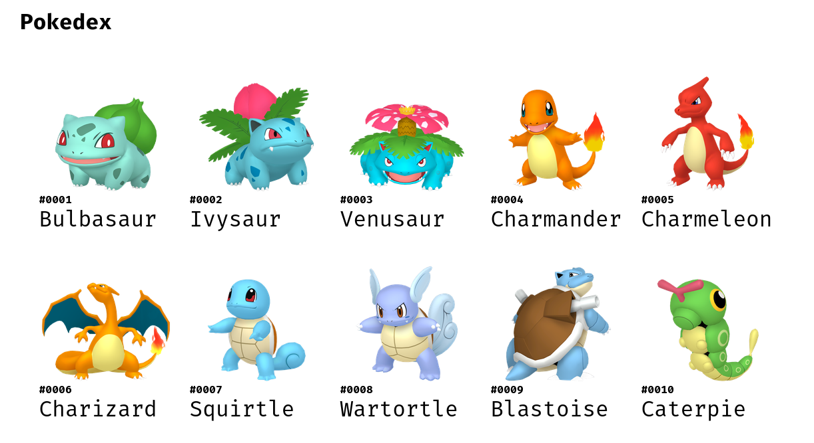

# Pokedex

Este projeto foi desenvolvido utlizando [Angular CLI](https://github.com/angular/angular-cli) versão 22.3.0.



## Pré-requisitos

Assumimos que o ambiente de desenvolvimento tenha instalados:

- nodejs;
- npm.

## Instalando dependências

Instale as bibliotecas necessárias com o seguinte comando:

```bash
npm install
```

## Servidor de desenvolvimento

Para rodar a aplicação em modo de desenvolvimento:

```bash
ng serve
```

Para visualizar a aplicação, navegue para `http://localhost:4200/`. 
